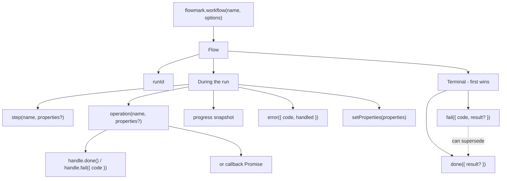

<p align="center">
  
</p>

<h1 align="center">flowmark.</h1>

<p align="center">
  <strong>Turn business processes into data-driven insight.</strong>
</p>

<p align="center">
  Open source · Operations insight · TypeScript SDK
</p>

<p align="center">
  <a href="./LICENSE"></a>
  <a href="https://flowmark.dev"></a>
</p>

Healthy servers are not a picture of operations. Mark the checkout, sync, or
job you already run. Flowmark records the operations, progress, errors, and
reported result — so you can see what the process produced, not reconstruct it
from logs.

Your application does the work. Flowmark observes it. It does not execute,
schedule, or retry that work.

```ts
const flow = flowmark.workflow("checkout.order", { properties: { orderId } })

try {
  await capturePayment(orderId)
  flow.step("payment-captured")
  const shipment = await flow.operation("create-shipment", () =>
    createShipment(orderId),
  )
  flow.done({ result: { shipmentId: shipment.id } })
  return shipment
} catch (error) {
  flow.fail({
    code: "CHECKOUT_FAILED",
    result: { paid: true, shipped: false },
  })
  throw error
}
```



A handled error or a failed operation does not fail the run. Only `done()` or
`fail()` ends it. Attach a bounded result on either — including partial work
on failure.

## What you get

- A small TypeScript SDK for Node.js, Next.js, and the browser
- An API that validates and stores workflow events
- A dashboard that groups executions by process and opens one run as evidence
- Explicit links between related runs — you pass IDs, Flowmark does not invent a trace

Flowmark is not a job runner, APM, log bucket, or product-analytics tool. Keep
those. Use Flowmark for the process and its reported outcome.

## Status

The local product works: instrument a process, ingest events, sign in to the
dashboard, and inspect a run. The SDK is not on npm yet. Hosted Flowmark,
key management in the UI, and a published package are the next product steps.

- Product: [flowmark.dev](https://flowmark.dev)
- SDK reference (this repo): [`apps/docs`](./apps/docs)
- Purpose and limits: [north star](./NORTH-STAR.md)

## Local development

Node.js 20.19+ (24 LTS recommended) and pnpm 10.

```sh
pnpm install
pnpm dev:setup
# Set DATABASE_URL in apps/server/.env.local to a running development database.
pnpm db:setup
pnpm dev
```

`pnpm dev` starts the apps and watches SDK/core. It does not start PostgreSQL
or apply migrations. For a working local pipeline, follow the
[development guide](./docs/development.md#local-demo-with-postgresql), then
open the dashboard at `http://127.0.0.1:3001`.

`apps/dev-harness` and `apps/internal-docs` are loopback-only. Do not deploy
them.

## Repository

| Path | Purpose |
| --- | --- |
| `packages/sdk` | `@flowmark/node` — Node, Next.js, and browser SDK |
| `packages/core` | Workflow domain and event contract |
| `packages/api` | Use cases, ports, and adapters |
| `packages/db` | Schema, migrations, and persistence |
| `packages/ui` | Shared UI primitives |
| `apps/server` | HTTP/tRPC shell |
| `apps/dashboard` | Operations dashboard |
| `apps/web` | Product landing |
| `apps/docs` | Customer documentation |
| `docs/` | Contributor architecture, decisions, and product guides |

## Contributing

- [Development commands](./docs/development.md)
- [Architecture](./docs/architecture.md)
- [Agent guidelines](./AGENTS.md)
- [Handoff](./HANDOFF.md)

License: [MIT](./LICENSE).
