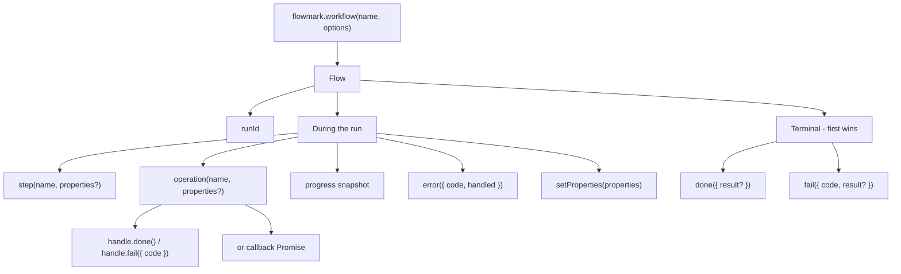
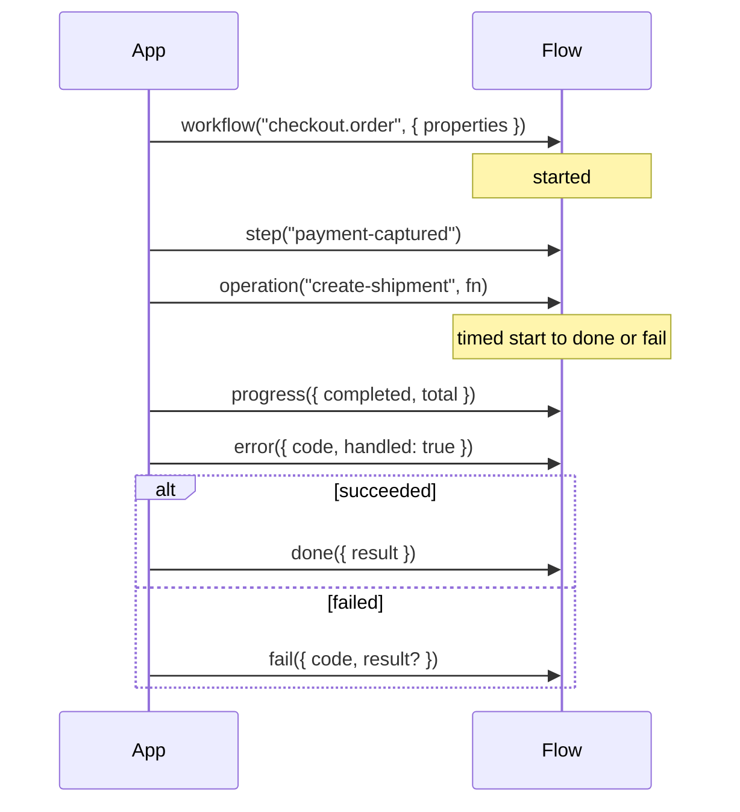

## A workflow is a named process

A workflow identifies a process your code already runs, such as
`invoice.import` or `order.fulfill`. Calling `flowmark.workflow(name)` starts
a new observed run.

Use a stable semantic name. Put the order ID or batch ID in properties, not
in the workflow name; otherwise every order becomes a different workflow.

## Each execution is a run

```ts
const run = flowmark.workflow("invoice.import", {
  properties: { batchId: "batch_2049" },
  environment: "production",
  release: "2026.10.2",
})
console.log(run.runId)
```

Each call generates a fresh SDK UUID unless you explicitly supply `id`.
Pass the same `id` and workflow name on a later request to continue that run —
for a battle that starts in one handler and is claimed in another, persist
`flow.runId` on your own record and pass it back. Do not reuse a durable
entity ID that outlives one execution; put those in properties.
The dashboard also has its own internal run UUID for queries and navigation;
it is different from the external SDK `runId`.

## Continue across requests

Transport a plain `WorkflowRunReference` explicitly in application-owned storage
or an authenticated callback payload. Credentials still determine project scope;
the reference is not authorization and correlation/parent IDs do not resume a run.

```ts
import type { WorkflowRunReference } from "@flowmarkdev/node"

// Submission request: the application submits a booking and saves/forwards ref.
const submission = flowmark.workflow("booking.create", {
  properties: { bookingRef: "synthetic-booking-42" },
})
const ref: WorkflowRunReference = {
  workflow: "booking.create",
  runId: submission.runId,
}
submission.step("awaiting-confirmation")
// No done(): provider confirmation has not been reported.

// Later authorized callback, possibly using a fresh client/process:
const callback = flowmark.workflow(ref.workflow, { id: ref.runId })
callback.setProperties({ confirmationReceived: true })
callback.done({ outcome: "confirmed", result: { reserved: 1 } })
```

The application validates and authorizes callbacks and deduplicates its own work.
Flowmark does not execute bookings, propagate context, coordinate workers or
provide global run state. A Node submission can flush/shutdown its client while
the stored run stays open; a later client can continue it. Next uses the reporting
request's existing after-drain lifecycle. Before confirmation, missing terminal
telemetry is neither failure nor proof the process is active.

Repeated starts for the same workflow and ID do not replace initial properties,
environment, release or links. Use `setProperties()` for accepted shallow
amendments while the run is open. A different attempt gets a new run ID, even
when it concerns the same booking reference. Related/correlated processes are
not automatically continued executions.

## Terminal decisions

The **first terminal event accepted by the server** closes the run. Concurrent
requests are serialized by persistence; application timestamps do not select a
winner. A local handle already ignores later terminal calls, while a fresh handle
cannot know remote state and may send a conflicting event.

Retrying the same envelope event ID is idempotent (`202`, `duplicate`). A callback
that sends another terminal with a new event ID gets `409`, `EVENT_CONFLICT`, even
if it repeats the same terminal type/result. It cannot replace the final result
or outcome. Other late markers are explicitly ignored (`202`, `accepted: false`,
`ignored`). SDK conflicts use existing delivery diagnostics and flush/shutdown
failures without replacing application return values or original errors. HTTP
409 is not automatically retried. A missing start is also 409, with the distinct
code `RUN_NOT_FOUND`.

Previously stored mixed-terminal histories retain their original failed
projection. Only future writes change; no historical events/results are rewritten.
An older backend still follows its old policy. Deploy the accepting backend
before relying on first-terminal behavior across requests.

## Lifecycle

| Marker                       | Meaning                                               |
| ---------------------------- | ----------------------------------------------------- |
| `workflow()`                 | Start a run                                           |
| `step()` / `setProperties()` | Record a checkpoint or context                        |
| `operation()`                | Measure an identified unit of work                    |
| `progress()`                 | Record an absolute snapshot                           |
| `error()`                    | Record a problem without ending the run               |
| `done()`                     | Request completion, optionally with a business result |
| `fail({ code, result? })`    | Mark the run failed without throwing                  |





Call `fail()` when the run should count as failed. A handled `error()` or a
failed operation stays on the timeline until you complete or fail the run.

After `done()` is requested, new run markers are ignored. Existing open
operations may still close; completion waits for the last one. An explicit
`fail()` can supersede pending completion **before its terminal event is sent**.
This waits only for operations on that local handle; another request can close
the run first, causing the deferred terminal to conflict when delivered.

## Last reported evidence

The run view shows recorded telemetry. If the process or delivery stops, the
last event is what operations can see — including last-reported progress.
Compare with application logs before deciding whether to retry.

Next: [business results](/docs/concepts/results) and the
[workflow API](/docs/reference/workflow).

## Find runs by business reference

Put safe application references in run-level properties, for example
`{ batchId: "synthetic-batch-42", provider: "crm-a" }`. In the workflow page,
explicitly enable `batchId` as a reference and `provider` as a category with
allowed values such as `crm-a` and `crm-b`. Up to eight top-level string keys are
supported, with up to twenty values per category. Enabling a key makes its
already stored values searchable; avoid secrets and personal identifiers.

In Run history, choose the workflow, business field and exact value. Reference
matching is case-sensitive, with no substring matching or whitespace trimming.
Categories accept only explicitly configured values. Filters apply to the full
recorded history, not just the latest overview snapshot. The URL preserves the
selected filters and can be copied or reopened. Pagination and match counts use
the same population.

Matching uses current run context: initial properties plus accepted shallow
`setProperties()` amendments. Step and operation properties do not participate.
A matched amended value does not prove that earlier operations used that value.
Missing, non-string, unconfigured and disabled properties produce no business
matches. Disabling a key also disables direct API filtering for that key.
Browser properties remain untrusted application-reported context.
