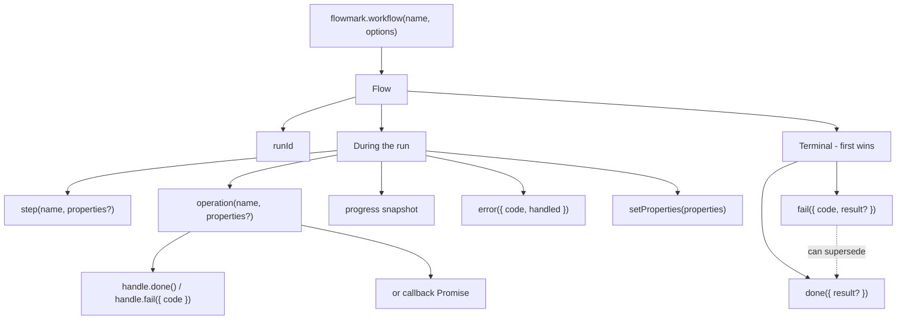
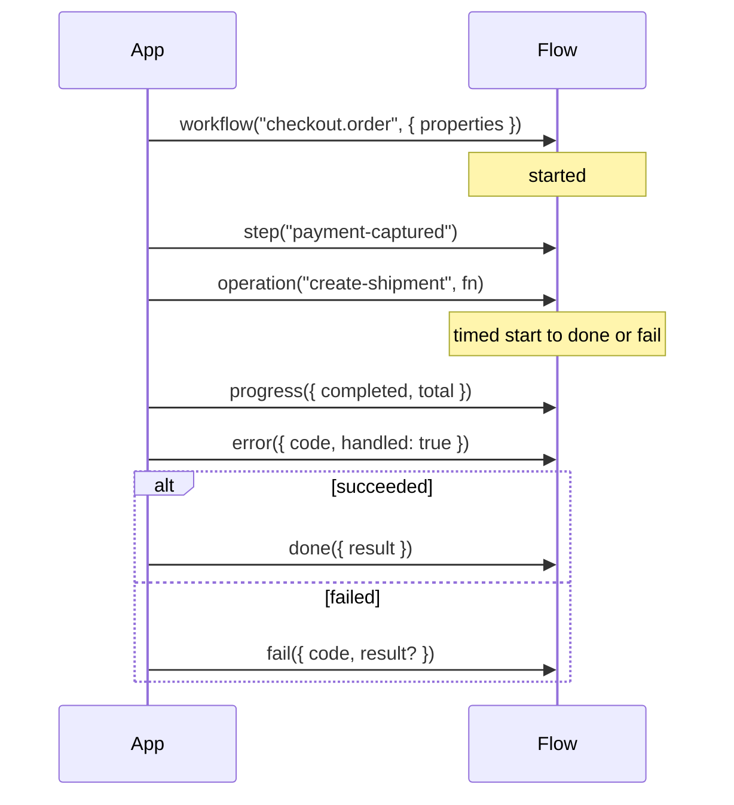

## A workflow is a named process

A workflow identifies a process your code already runs, such as
`invoice.import` or `order.fulfill`. Calling `flowmark.workflow(name)` starts
a new observed run.

Use a stable semantic name. Put the order ID or batch ID in properties, not
in the workflow name; otherwise every order becomes a different workflow.

## Each execution is a run

```ts
const run = flowmark.workflow("invoice.import", {
  properties: { batchId: "batch_2049" },
  environment: "production",
  release: "2026.10.2",
})
console.log(run.runId)
```

Each call generates a fresh SDK UUID unless you explicitly supply `id`.
Pass the same `id` and workflow name on a later request to continue that run —
for a battle that starts in one handler and is claimed in another, persist
`flow.runId` on your own record and pass it back. Do not reuse a durable
entity ID that outlives one execution; put those in properties.
The dashboard also has its own internal run UUID for queries and navigation;
it is different from the external SDK `runId`.

```ts
// First request
const flow = flowmark.workflow("expedition.run", { id: expeditionId })
flow.step("draft-started")

// Later request
const flow = flowmark.workflow("expedition.run", { id: expeditionId })
flow.step("battle-claimed")
flow.done({ result: { battlesWon: 2 } })
```

A second `started` for the same run is ignored. Call `done()` or `fail()` only
when the whole process ends. Use [related runs](/docs/concepts/related-runs)
when the later work is a *different* process, not the same execution.

## Lifecycle

| Marker                       | Meaning                                               |
| ---------------------------- | ----------------------------------------------------- |
| `workflow()`                 | Start a run                                           |
| `step()` / `setProperties()` | Record a checkpoint or context                        |
| `operation()`                | Measure an identified unit of work                    |
| `progress()`                 | Record an absolute snapshot                           |
| `error()`                    | Record a problem without ending the run               |
| `done()`                     | Request completion, optionally with a business result |
| `fail({ code, result? })`    | Mark the run failed without throwing                  |





Call `fail()` when the run should count as failed. A handled `error()` or a
failed operation stays on the timeline until you complete or fail the run.

After `done()` is requested, new run markers are ignored. Existing open
operations may still close; completion waits for the last one. An explicit
`fail()` can supersede pending completion.

## Last reported evidence

The run view shows recorded telemetry. If the process or delivery stops, the
last event is what operations can see — including last-reported progress.
Compare with application logs before deciding whether to retry.

Next: [business results](/docs/concepts/results) and the
[workflow API](/docs/reference/workflow).
