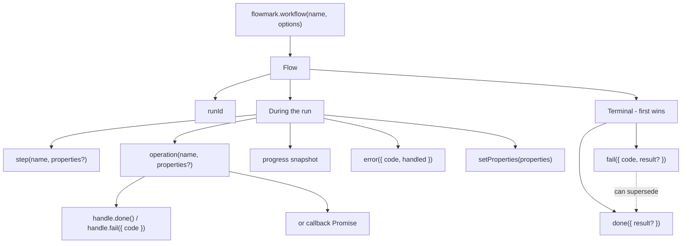
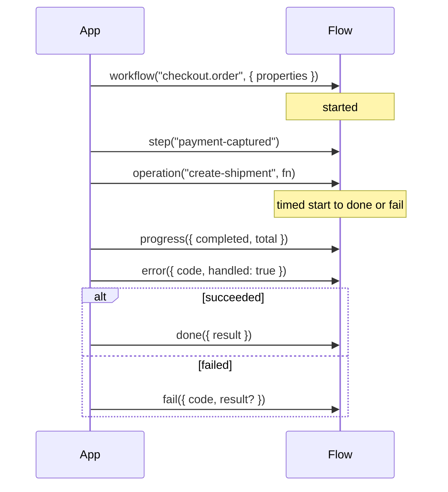

## A workflow is a name, not an executor

A workflow identifies a process your code already runs, such as
`invoice.import` or `order.fulfill`. Flowmark does not register or execute a
workflow definition. Calling `flowmark.workflow(name)` starts a new observed run.

Use a stable semantic name. Put the order ID or batch ID in properties, not
in the workflow name; otherwise every order becomes a different workflow.

## Each execution is a run

```ts
const run = flowmark.workflow("invoice.import", {
  properties: { batchId: "batch_2049" },
  environment: "production",
  release: "2026.10.2",
})
console.log(run.runId)
```

Each call generates a fresh SDK UUID unless you explicitly supply `id`.
Do not reuse a business ID as an execution ID across retries.
The dashboard also has its own internal run UUID for queries and navigation;
it is different from the external SDK `runId`.

## Lifecycle

| Marker                       | Meaning                                               |
| ---------------------------- | ----------------------------------------------------- |
| `workflow()`                 | Start a run                                           |
| `step()` / `setProperties()` | Record a checkpoint or context                        |
| `operation()`                | Measure an identified unit of work                    |
| `progress()`                 | Record an absolute snapshot                           |
| `error()`                    | Record a problem without ending the run               |
| `done()`                     | Request completion, optionally with a business result |
| `fail({ code, result? })`    | Mark the run failed without throwing                  |





`error({ handled: false })` alone does **not** fail the run. An operation failure
does not either. Your code must call `fail()` for a terminal failed outcome.

After `done()` is requested, new run markers are ignored. Existing open
operations may still close; completion waits for the last one. An explicit
`fail()` can supersede pending completion. After terminal completion/failure,
later markers do not reopen the run.

## Missing completion is uncertainty

The run view describes recorded telemetry. If the process or delivery stops,
the last event may be all that is available. A started run is not proof that
work is still active; last-reported progress is not a verified database state.
Compare with application logs before deciding whether to retry.

Next: [business results](/docs/concepts/results) and the
[workflow API](/docs/reference/workflow).
