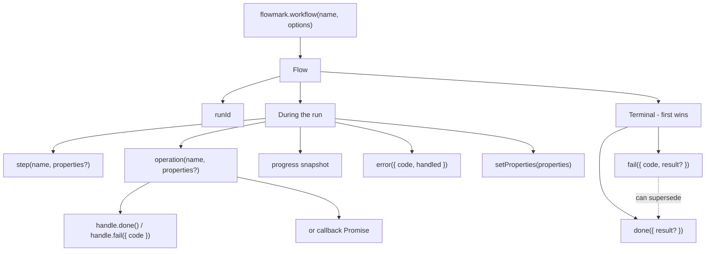

## Client and configuration

| API                                                          | Purpose                                         |
| ------------------------------------------------------------ | ----------------------------------------------- |
| [`createFlowmark(config?)`](/docs/reference/create-flowmark) | Create a Node.js, Next.js, or browser client    |
| [`defineConfig(config)`](/docs/reference/define-config)      | Type-check configuration without loading a file |
| [`flush()` / `shutdown()`](/docs/reference/delivery)         | Wait for delivery or close a client             |

[`defineWorkflow()`](/docs/reference/define-workflow) creates optional reusable typed definitions.

## Run markers

Get a run handle with `flowmark.workflow(name, options?)`.
All marker methods below return `void` except `operation()`.
See [workflows and runs](/docs/concepts/runs) for the lifecycle map.

| API                                                | Purpose                                             |
| -------------------------------------------------- | --------------------------------------------------- |
| [`workflow()` / `runId`](/docs/reference/workflow) | Start an independent execution and identify it      |
| [`step()`](/docs/reference/step)                   | Record a semantic checkpoint without executing code |
| [`operation()`](/docs/reference/operation)         | Measure an independently identified operation       |
| [`progress()`](/docs/reference/progress)           | Record absolute progress so far                     |
| [`report()`](/docs/reference/report)               | Record a whole non-final business snapshot          |
| [`error()`](/docs/reference/error)                 | Record a problem without ending the run             |
| [`done()` / `fail()`](/docs/reference/completion)  | Report terminal completion or failure               |
| [`setProperties()`](/docs/reference/properties)    | Append discovered context                           |

## Types and adapters

- [Data types and bounds](/docs/reference/types): JSON values, results, failures,
  progress, and exported types.
- [Browser proxy](/docs/reference/proxy): `createFlowmarkProxy()` and its responses.
- [Advanced exports](/docs/reference/advanced): custom transports, low-level
  `workflow()`, memory transport, and typed errors.

## Runtime differences

The normal Node.js and browser clients expose `workflow`, `flush`, and
`shutdown`. The Next.js adapter exposes **only `workflow`** and manages delivery
with `after()`. Run handles have the same marker API across integrations.

Need a runnable starting point rather than a method lookup? Read the
[quickstart](/docs/sdk), [Next.js guide](/docs/nextjs), or
[browser guide](/docs/browser).
